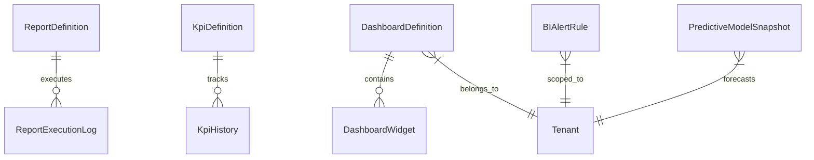

# GBS Phase 15 Architecture: Enterprise Analytics, Business Intelligence & Reporting Platform

## Executive Summary

Phase 15 delivers a centralized Enterprise Analytics, Reporting, KPI, Dashboard, Business Intelligence, and Executive Decision Support platform for Global Business Suite (GBS). The architecture provides real-time metric aggregation across all core subsystems (Admin, Partner, Customer, Billing, CRM, AI Engine, GBP, Social Media), self-service drag-and-drop dashboard building, predictive analytics forecasting models, AI trend and anomaly explanations, executive scorecards, and multi-channel scheduled delivery (Email, WhatsApp API, In-App).

---

## Architectural Principles

1. **Zero Duplication**: Reuses existing transactional and operational tables (`Subscription`, `Invoice`, `Review`, `SocialPost`, `CrmLead`, `CrmOpportunity`, `AiUsageLog`, `GbpInsight`, `AuditLog`).
2. **Real-Time Data Streaming**: Employs Server-Sent Events (SSE) `/api/v1/analytics-engine/stream/live` for live dashboard telemetry updates without heavy polling.
3. **Multi-Tenant Data Isolation**: All report queries, dashboards, KPIs, and forecasts enforce mandatory `tenantId` boundary filters.
4. **Role-Based Access Control (RBAC)**: Custom SQL execution is restricted strictly to `SUPER_ADMIN` and `ADMIN` users within a sanitized, parameterized SELECT-only sandbox.
5. **AI-Powered Analytics**: Integrates multi-LLM orchestration for natural language report building (`/reports/ai-builder`) and root cause anomaly explanations (`/ai-insights/explain-trend`).
6. **Multi-Channel Delivery Engine**: Automates PDF/CSV/Excel/JSON report distribution via Email, WhatsApp API, and In-App Notifications.

---

## Database Models (`packages/database/prisma/schema.prisma`)

### Core Models
- `ReportDefinition`: Custom and system visual report definitions supporting Table, Chart, Pivot, Matrix, HeatMap, KPICard, Funnel, GeoMap, Timeline, and Custom SQL.
- `ReportExecutionLog`: Audit log capturing execution latency, row counts, and export formats.
- `KpiDefinition`: Configurable enterprise KPIs across Revenue, MRR, ARR, Growth, Churn, LTV, ARPU, CSAT, NPS, GBP Rating, and SLA Uptime.
- `KpiHistory`: Historical snapshot data points for trend analysis and predictive modeling.
- `BIAlertRule`: Threshold alert rules for automated multi-channel dispatch.
- `DashboardDefinition`: 16 domain dashboards + Executive Scorecard containers with drag & drop grid metadata.
- `DashboardWidget`: Dynamic widget components with configurable refresh intervals and SSE channels.
- `PredictiveModelSnapshot`: Forecast snapshots for Revenue ARR, Churn Risk, Customer Growth, and Campaign ROI.

---

## API Endpoints Reference

| Method | Endpoint | Description | Access |
|---|---|---|---|
| `GET` | `/api/v1/analytics-engine/dashboards/:type` | Domain dashboards (Executive, System, Admin, Partner, Customer, Finance, CRM, AI, GBP, Social, etc.) | Authenticated |
| `GET` | `/api/v1/analytics-engine/scorecards/:type` | Executive Scorecards (Platform Owner, Partner, Customer) | Authenticated |
| `GET` | `/api/v1/analytics-engine/stream/live` | SSE Real-Time Telemetry Stream | Authenticated |
| `GET` | `/api/v1/analytics-engine/dashboards/builder/widgets` | Drag & Drop Widget Library | Authenticated |
| `POST` | `/api/v1/analytics-engine/predictive/forecast` | Predictive Analytics Engine (Revenue, Churn, Growth) | Authenticated |
| `POST` | `/api/v1/analytics-engine/ai-insights/explain-trend` | AI Trend & Anomaly Explanation Engine | Authenticated |
| `GET` | `/api/v1/analytics-engine/reports` | List Report Definitions | Authenticated |
| `POST` | `/api/v1/analytics-engine/reports` | Create Custom Visual Report | Authenticated |
| `POST` | `/api/v1/analytics-engine/reports/:id/execute` | Execute Report Query | Authenticated |
| `POST` | `/api/v1/analytics-engine/reports/:id/clone` | Clone Report | Authenticated |
| `POST` | `/api/v1/analytics-engine/reports/ai-builder` | AI-Assisted Report Builder | Authenticated |
| `POST` | `/api/v1/analytics-engine/reports/:id/export` | Export Report (PDF, Excel, CSV, JSON, Print) | Authenticated |
| `POST` | `/api/v1/analytics-engine/reports/:id/deliver` | Multi-Channel Delivery (Email, WhatsApp, In-App) | Authenticated |
| `GET` | `/api/v1/analytics-engine/kpis` | Configurable KPIs & Real-Time Values | Authenticated |
| `POST` | `/api/v1/analytics-engine/kpis` | Create Custom KPI Definition | Authenticated |
| `POST` | `/api/v1/analytics-engine/custom-sql` | Admin Custom SQL Console (Strict SELECT-only) | Admin Only |
| `GET` | `/api/v1/analytics-engine/alerts` | Active BI Threshold Alerts | Authenticated |
| `GET` | `/api/v1/analytics-engine/search` | Enterprise BI Search across dashboards, reports, KPIs | Authenticated |

---

## Portal & Mobile Apps Integration

- **Admin Portal**: Fully integrated BI Hub in `/analytics` featuring 16 domain dashboards, Executive Scorecards, Drag & Drop Builder, Predictive Forecasting, AI Trend Explanations, Visual Report Builder, and Custom SQL console.
- **Partner Portal**: Partner Analytics Hub in `/analytics` with Partner Scorecards, Managed Client BI, Predictive Marketing ROI, and Scheduled WhatsApp/Email delivery.
- **Customer Portal**: Self-service Reports Hub in `/reports` with Customer Scorecards, Loyalty Points, Order/Invoice history, and PDF usage statement downloads.
- **Mobile Apps**: Feature parity across `admin-mobile`, `partner-mobile`, and `customer-mobile` via dedicated `ANALYTICS` and `REPORTS` tabs.
