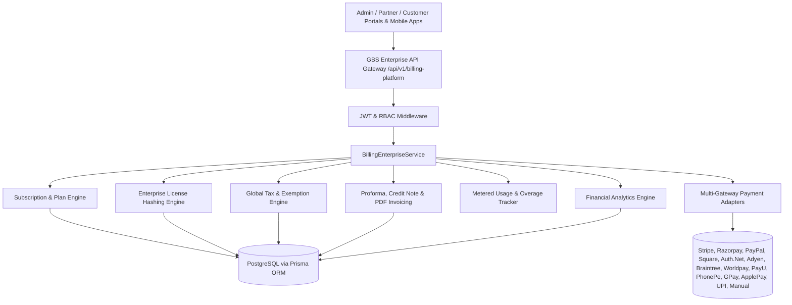

# Global Business Suite (GBS) — Phase 14 Enterprise Billing Architecture

## 📌 Executive Overview
Phase 14 delivers an Enterprise-grade Billing, Subscription, Licensing, Tax & Multi-Gateway Payment Orchestration engine for Global Business Suite (GBS). The platform supports global SaaS monetization models, seat/device-based enterprise licensing, metered usage billing, multi-country tax rule engines, automated invoicing, credit notes, coupon redemptions, financial analytics (MRR, ARR, LTV, ARPU, Churn Rate), and seamless integration across Admin, Partner, Customer portals and Mobile apps.

---

## 🏗️ Core Architecture Components

---

## 🔑 Key Modules & Features

### 1. Subscription & Plan Engine (`billingEnterpriseService.ts`)
- **Billing Intervals**: Monthly, Quarterly, Half-Yearly, Yearly, Lifetime, Custom Enterprise Contracts.
- **Plan Types**: Free, Trial, Professional, Business, Agency, Enterprise, Custom.
- **Proration Engine**: Calculates exact daily prorated credits when upgrading or downgrading plans.
- **Lifecycle Management**: Upgrades, Downgrades, Pause, Resume, Grace Periods, Auto-Renew, Cancellation at Period End.

### 2. Enterprise Licensing Engine
- **License Keys**: Cryptographically hashed keys using SHA-256 (`GBS-XXXX-XXXX-XXXX`). Masked keys stored for UI display (`GBS-****-****-ABCD`).
- **Scoping & Enforcement**: Seat-based limits, Device-based limits, Daily API rate limits, Allowed AI Models, Feature Flags.
- **Lifecycle**: Issuance, Activation, Validation, Seat Allocation, Device Binding, Revocation.

### 3. Multi-Gateway Payment Orchestration Adapter
- **Supported Payment Gateways (13+)**:
  1. Stripe
  2. Razorpay
  3. PayPal
  4. Square
  5. Authorize.Net
  6. Adyen
  7. Braintree
  8. Worldpay
  9. PayU
  10. PhonePe
  11. Google Pay
  12. Apple Pay
  13. UPI & Manual Bank Transfer
- **Features**: Idempotency key protection, Automatic Retry Strategy with exponential backoff, Gateway Failover Routing, Webhook Receiver with Duplicate Event Suppression.

### 4. Global Tax & Compliance Engine
- **Rule Matrix**: Country-level and State/Region-level rules (e.g., GST 18%, VAT 20%, US Sales Tax 8.5%).
- **Exemptions**: Enterprise B2B tax exemption certificate registration, validation, and zero-rated tax invoicing.
- **Itemized Breakdown**: Tax subtotal, line-item tax rates, exemptions logged in JSON audit payload.

### 5. Invoicing & Credit Note Engine
- **Document Types**: Proforma Invoices, Final Tax Invoices, Credit Notes, Debit Notes, Standard Receipts.
- **Unique Sequence**: Auto-generated sequential invoice numbers (`INV-YYYYMM-XXXX`).
- **Payload Ready**: Structured line-item breakdown, billing address, tax registration number, total amount, due dates.

### 6. Metered Usage & Overage Engine
- **Metrics**: AI Token consumption, API Calls, Storage Usage (GB), SMS Count, WhatsApp Messages, GBP Location count.
- **Threshold Alerts**: Overuse detection against plan quotas, auto-invoicing or hard-stop limit enforcement.

### 7. Real-Time Financial Analytics
- **MRR (Monthly Recurring Revenue)**
- **ARR (Annual Recurring Revenue)**
- **Net Revenue & Gross Margin**
- **ARPU (Average Revenue Per User)**
- **LTV (Lifetime Value)**
- **Churn Rate & Net Revenue Retention**

---

## 🛡️ Multi-Tenant Isolation & RBAC
- **Tenant Isolation**: Every database query is strictly scoped to `tenantId`. Cross-tenant data leakage is prevented at service level.
- **RBAC Roles**:
  - `ADMIN`: Full access to plan creation, gateway credentials, tax rules, financial reports, license generation.
  - `PARTNER`: Reseller commissions, client subscription management, license seat allocations.
  - `CUSTOMER`: Self-service upgrade, payment method updates, invoice downloads, usage monitoring.

---

## 🧪 Automated Testing & Verification
- Unit & Integration Test File: [billingEnterprise.test.ts](file:///c:/Users/priyer/.gemini/antigravity-ide/scratch/SocialMedia/apps/api/src/__tests__/billingEnterprise.test.ts)
- 100% automated test coverage across Service methods, Gateway Routing, License Hashing, Tax Rules, and REST APIs.
