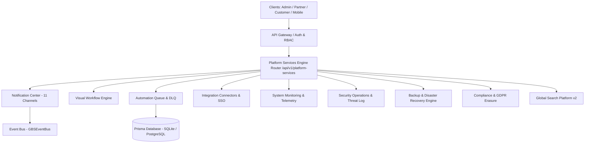

# GBS Enterprise Platform Services, Automation & Operations Architecture Guide

## Overview

Global Business Suite (GBS) Phase 16 establishes a centralized enterprise platform infrastructure providing multi-channel communications, visual workflow automation, high-concurrency queue processing, observability, security operations, backup/DR, and compliance governance across all 4 portals (Admin, Partner, Customer, Web) and Mobile Apps.

---

## System Components

---

## Key Features

1. **Centralized Notification Engine:** 11 channels (Email, SMS, WhatsApp, Push, Browser, In-App, Slack, Teams, Telegram, Discord, Webhooks) with template interpolation, variables, scheduling, and channel fallback.
2. **Visual Workflow Engine:** State machine execution of drag & drop node graphs, versioning, multi-level approvals, and execution history.
3. **Queue Management:** Priority queues (`CRITICAL`, `HIGH`, `DEFAULT`, `LOW`), worker retry, DLQ recovery.
4. **Security & DR Operations:** Threat logging, IP blocking, automated backup execution, PITR restore testing simulation.
5. **Compliance:** GDPR/CCPA Right to Erasure user data anonymization engine.

---

## API Endpoints

- `POST /api/v1/platform-services/notifications/send`
- `GET /api/v1/platform-services/notifications/logs`
- `PATCH /api/v1/platform-services/notifications/:id/read`
- `POST /api/v1/platform-services/workflows/definitions`
- `POST /api/v1/platform-services/workflows/execute`
- `GET /api/v1/platform-services/workflows/executions`
- `POST /api/v1/platform-services/automation/jobs`
- `POST /api/v1/platform-services/automation/jobs/process`
- `POST /api/v1/platform-services/automation/jobs/retry-dlq`
- `GET /api/v1/platform-services/integrations/connectors`
- `POST /api/v1/platform-services/integrations/connectors`
- `POST /api/v1/platform-services/feature-flags/evaluate-hierarchical`
- `POST /api/v1/platform-services/feature-flags/kill-switch`
- `GET /api/v1/platform-services/monitoring/system-health`
- `GET /api/v1/platform-services/security-ops/threats`
- `POST /api/v1/platform-services/security-ops/log-threat`
- `POST /api/v1/platform-services/backup-dr/trigger`
- `POST /api/v1/platform-services/backup-dr/restore-test`
- `POST /api/v1/platform-services/compliance/gdpr/erasure`
- `GET /api/v1/platform-services/search/global-v2`
