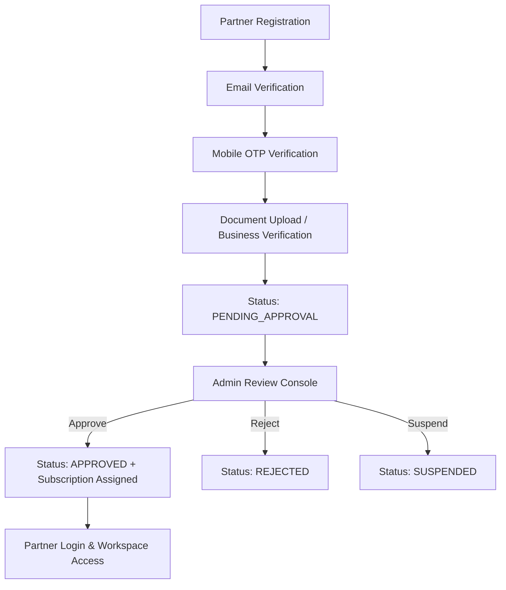
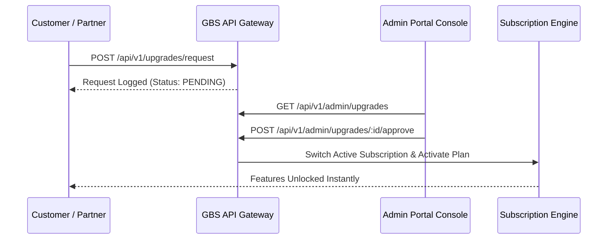

# Enterprise Registration, Approval, Subscription and Access Management Guide

## Overview

Global Business Suite (GBS) provides an enterprise multi-tenant Registration, Approval, Subscription, and Access Management Framework. Every portal (Admin, Partner, Customer, Web) and mobile application (Admin Mobile, Partner Mobile, Customer Mobile) enforces a unified architecture while maintaining strict portal-specific security boundaries.

---

## 1. Portal Registration Rules

| Portal / Mobile App | Registration Allowed | Verification Required | Approval Required | Login Behavior |
| :--- | :--- | :--- | :--- | :--- |
| **Admin Portal** | ❌ Disabled | N/A | N/A | Login Only (Created by Super Admin) |
| **Admin Mobile** | ❌ Disabled | N/A | N/A | Login Only |
| **Partner Portal** | ✅ Allowed | Email + Mobile OTP + Business Docs | ✅ Mandatory Admin Approval | Login blocked until status = `APPROVED` |
| **Partner Mobile** | ✅ Allowed | Email + Mobile OTP + Business Docs | ✅ Mandatory Admin Approval | Login blocked until status = `APPROVED` |
| **Customer Portal**| ✅ Allowed | Mobile OTP (WhatsApp Optional) | ❌ Instant Account Access | Immediate Login (Controlled by Subscriptions & RBAC) |
| **Customer Mobile**| ✅ Allowed | Mobile OTP (WhatsApp Optional) | ❌ Instant Account Access | Immediate Login (Controlled by Subscriptions & RBAC) |

---

## 2. Partner Onboarding & Approval Lifecycle

### Partner Approval States
1. **PENDING_APPROVAL**: Default state upon registration. Login attempts return `APPROVAL_RESTRICTED`. Business operations locked.
2. **APPROVED**: Admin approved application. Active subscription assigned. Full portal access enabled.
3. **REJECTED**: Application declined by Admin.
4. **SUSPENDED**: Account temporarily frozen due to compliance or billing reasons.
5. **BLOCKED**: Account hard-blocked due to security violations.
6. **ARCHIVED**: Account deactivated and safely archived.

---

## 3. Subscription Engine & Access Management

Permissions are **never hardcoded to login status or user roles**. Access is dynamically evaluated at runtime based on:

$$\text{Effective Access} = \text{Assigned Subscription Plan} + \text{RBAC Roles} + \text{Feature Flags} + \text{Tenant Configuration}$$

### View vs Action Permission Matrix

Every module enforces granular action separation (`view`, `create`, `edit`, `delete`, `approve`, `export`, `import`, `share`, `ai`, `api`):

| Module | Customer Allowed Actions | Partner Allowed Actions | Upgrade Path |
| :--- | :--- | :--- | :--- |
| **Reviews** | View Reviews | View, Reply, Auto-Respond, Export | Upgrade to Growth / Scale Plan |
| **Google Business** | View Profile & Insights | View, Edit, Publish, Sync Locations | Upgrade to Enterprise Plan |
| **Analytics** | View Dashboards | View, Generate Reports, Export CSV | Upgrade to Pro Analytics Plan |
| **Social Publishing** | View Posts | View, Create, Schedule, Cross-Post | Upgrade to Social Media Add-on |

### Feature Locking Contract (`POST /api/v1/access/evaluate`)

When a feature or action is unavailable under the current plan:
- The UI displays the module with an **Upgrade Required** banner or lock icon (rather than hiding it).
- A one-click **Request Upgrade** button triggers the automated upgrade workflow.

---

## 4. Subscription Limits Matrix

### Partner Subscription Limits
- Max Customers
- Max Employees
- Max Organizations
- Max Google Accounts & Profiles
- Max Locations
- Max Social Accounts & Posts
- Max AI Token Usage
- Max Storage (MB)
- Max WhatsApp / SMS / Email Messages
- Max Calls & Appointments

### Customer Subscription Limits
- Business Profiles & Locations
- Posts & Review Replies
- WhatsApp / SMS / Email Marketing Campaigns
- AI Assistant Usage
- Bookings & Unified Inbox Conversations

---

## 5. Upgrade Requests & Immediate Activation

---

## 6. Audit Logging & System Events

All lifecycle transitions generate structured audit logs (`prisma.auditLog`):
- `PARTNER_REGISTRATION_SUBMITTED`
- `CUSTOMER_REGISTERED`
- `PARTNER_APPROVED`, `PARTNER_REJECTED`, `PARTNER_SUSPENDED`
- `UPGRADE_REQUEST_SUBMITTED`, `UPGRADE_REQUEST_APPROVED`, `UPGRADE_REQUEST_REJECTED`
- `ACCESS_DENIED`
